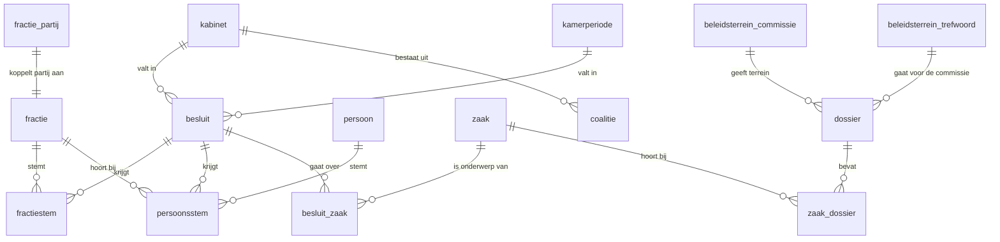

# Datamodel: de core-laag

De core-laag (schema `core`) is het opgeschoonde datamodel waarop de analyses draaien. Ze staat boven de raw-laag (schema `raw`, een ruwe kopie van de API van de Tweede Kamer) en wordt na elke dagelijkse verversing volledig opnieuw opgebouwd door de functie `core.herbouw()`. Gedefinieerd in `db/migrations/003_core.sql`.

Overal weggelaten: verwijderde records, besluiten voor 2010 en besluiten zonder datum. Een periode loopt van begin tot (niet tot en met) einde; een leeg einde betekent dat de periode nog loopt.

## Handmatige tabellen

Gevuld in de migratie en rij voor rij nagekeken door Niels; de kolom `gecontroleerd_op` toont wanneer.

### kabinet

Een rij per kabinet sinds Balkenende IV, met begin, einde en het Wikidata-nummer als bron. Een kabinet loopt tot het volgende kabinet is beëdigd: de demissionaire fase telt bij het kabinet waar die uit voortkomt. De kolom voor coalitiefracties is in R1 nog leeg.

### kamerperiode

Een rij per zittingsperiode van de Tweede Kamer, van de installatie van de nieuwe Kamer tot de installatie van de volgende. De installatiedatum is afgeleid uit de API (de dag waarop tientallen Kamerleden tegelijk in een fractie beginnen); de verkiezingsdatum staat ernaast ter informatie.

### fractie_partij

Koppelt een fractie aan een partij, of aan niets. Fractie en partij zijn niet hetzelfde: een groep of een afgesplitst Kamerlid vormt een fractie zonder partij. Bevat de fracties die op of na 1 januari 2010 actief waren; twijfelgevallen hebben een opmerking.

### coalitie

Welke fracties in welk kabinet zaten (rol `kabinet`) of het kabinet gedoogden (rol `gedoogsteun`), met een datum van uittreden als een fractie tussentijds opstapte. Gekoppeld op de afkorting van de fractie. Toegevoegd op 24 oktober 2026 (vervroegd op verzoek van Niels), bron per rij.

### beleidsterrein_commissie

Zet een vaste commissie (naam zoals in de API, in kleine letters) om in een van vijftien beleidsterreinen, zodat namen die per kabinet veranderen onder hetzelfde terrein vallen. Een commissie die hier niet staat, telt als 'Overig'. Opgesteld op 25 oktober 2026 (`db/migrations/014_onderwerpen.sql`), nog na te kijken door Niels.

### beleidsterrein_trefwoord

Trefwoorden (patronen) in de titel van een dossier die het beleidsterrein bepalen, vóór de commissie: zo vallen asiel, wonen en digitalisering onder hun eigen terrein, ook in de jaren dat een andere commissie ze behandelde. Toegevoegd op 25 oktober 2026 (`db/migrations/015_trefwoorden.sql`), nog na te kijken door Niels.

## Afgeleide tabellen

Opnieuw opgebouwd door `core.herbouw()`. Het zijn unlogged tabellen (`db/migrations/004_core_unlogged.sql`): Postgres schrijft er geen transactielog voor, wat de schrijflast van de nachtelijke herbouw halveert. Na een crash van de database zijn ze leeg tot de volgende herbouw.

### fractie

Elke fractie uit de API, met afkorting, naam, de periode waarin ze actief was en de partij uit `fractie_partij`. Bij een splitsing, fusie of naamswijziging maakt de API een nieuwe fractie aan met een eigen begindatum, zodat een stem altijd verwijst naar de fractie zoals die op dat moment bestond.

### persoon

Elk Kamerlid uit de API, alleen met naam en fractielabel. Geboortedatum, woonplaats en andere persoonsgegevens worden niet geladen (data-minimalisatie).

### besluit

Elk besluit met minstens een stemming, met de datum van de vergadering (via agendapunt en activiteit, in Nederlandse tijd), de soort stemming (met handopsteken of hoofdelijk), en het kabinet en de Kamerperiode waarin die datum valt.

### fractiestem

De stem van een fractie op een besluit: voor, tegen of niet deelgenomen, met de fractiegrootte en de vlag dat de fractie zich vergiste. Bestaat niet bij hoofdelijke stemmingen: daar levert de bron alleen stemmen per Kamerlid.

### persoonsstem

De stem van een Kamerlid op een besluit, met de fractie waartoe het Kamerlid toen behoorde. Vrijwel alleen bij hoofdelijke stemmingen.

### zaak

De zaken (moties, wetsvoorstellen en dergelijke) waarover een besluit met een stemming is genomen, met nummer, soort, titel en onderwerp. Let op: bij moties en amendementen is de titel die van het hele dossier (bijvoorbeeld een wetsvoorstel of een begroting); waar de zaak over gaat, staat in onderwerp.

### besluit_zaak

Koppelt een besluit aan de zaak of zaken waar het over gaat. Deze koppeling staat in de API niet als veld in het besluit, maar als relatie; `ingest` laadt hem apart.

### dossier

Elk Kamerstukdossier met nummer, toevoeging en titel, de vaste commissie die het vaakst voortouwcommissie is van de zaken in dat dossier ('TK' telt niet), en het beleidsterrein uit `beleidsterrein_commissie`. Opgebouwd door `core.herbouw_dossiers()` (component onderwerpen).

### zaak_dossier

Koppelt een zaak waarover gestemd is aan de dossiers waar die bij hoort. Een zaak kan bij meer dossiers horen; een stemming telt dan mee bij elk beleidsterrein (besluit Niels, 25 oktober 2026).
